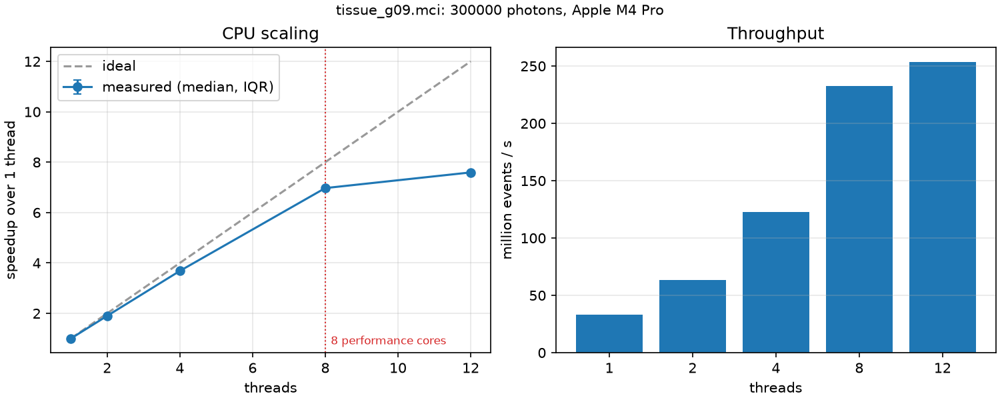

# TissueMC

**Validated Monte Carlo simulation of light transport in layered biological tissue, with a measured GPU optimization study.**

> **Status: under construction.** The CPU engine is built, validated, cross-checked against the original MCML and benchmarked. The first CUDA rung (R0, the naive baseline) is written and its per-photon kernel body is tested against the CPU engine on the host, but it has **not been run on a GPU yet**: no GPU results are claimed. Every number below traces to a committed file in [`results/`](results) and the command that produced it.

TissueMC reimplements the layered-tissue model of [MCML](https://omlc.org/software/mc/) (Wang, Jacques & Zheng, 1995) as:

- a multithreaded C++ CPU engine (float64), **done**, and
- a CUDA engine (float32 transport), **rung R0 written, not yet run on a GPU** (see [`docs/rungs/R0.md`](docs/rungs/R0.md) and [`LOG.md`](LOG.md)).

Both engines share one physics code path (`include/tissuemc/physics.hpp`). Nothing is benchmarked until it passes validation against published reference values. [`docs/DESIGN.md`](docs/DESIGN.md) has the full design.

This is a reimplementation for study and measurement, not new science: GPU photon-transport codes already exist (CUDAMCML, MCX). What this repository adds is correctness checked against published values and an independent first-principles calculation, plus a documented performance study.

## Quick start

```bash
uv sync                                  # Python analysis tools + build tools (cmake, ninja)
uv run cmake -S . -B build -G Ninja      # configure
uv run cmake --build build               # build engine + tests
uv run ctest --test-dir build --output-on-failure
uv run pytest
uv run tissuemc-validate                 # validation suite, ~20 s
./build/tissuemc run configs/validation/v1_slab.mci --photons 1000000 --threads 0
```

## Validation (CPU engine)

`uv run tissuemc-validate` runs four cases with 4 million photons each and compares them with published values and with an independent calculation ([`oracle.py`](python/tissuemc_analysis/oracle.py), Chandrasekhar's H-function). It passes if every estimate is within 3 combined standard errors of the reference plus the reference's rounding. The pass rule was fixed before the comparisons were run.

Headline results (seed 1, 4,000,000 photons, 50 batches; all 24 checks pass; full list in [`results/validation-cpu.json`](results/validation-cpu.json)):

| Case | Quantity | This engine | Reference | z | Reference source |
|---|---|---|---|---|---|
| V1 thin slab, matched boundary | R_d | 0.09741 ± 0.00011 | 0.09739 | +0.15 | van de Hulst (MCML manual, Table 6.1) |
| V1 thin slab, matched boundary | T_t | 0.66098 ± 0.00018 | 0.66096 | +0.11 | van de Hulst (Table 6.1) |
| V2 semi-infinite, n = 1.5 | R_d + R_sp | 0.25986 ± 0.00014 | 0.26000 | −0.99 | Giovanelli (Table 6.2) |
| V2 semi-infinite, n = 1.5 | R_d | 0.21986 ± 0.00014 | 0.21970 | +1.06 | H-function calculation |
| O1 semi-infinite, matched | R_d | 0.41488 ± 0.00018 | 0.41495 | −0.37 | H-function calculation |
| V3 three layers | R_d | 0.23796 ± 0.00016 | 0.23750 | +1.26 | MCML (Table 6.7) |
| V3 three layers | **T_t** | **0.09600 ± 0.00009** | 0.09650 | **−2.58** | MCML (Table 6.7) |

Each run also checks that energy is conserved and that no photon ends with a non-finite weight or a non-unit direction.

**V3 transmittance sits 2.6σ below the printed Table 6.7 value.** The cross-check below explains this: the original program itself, run at high statistics, gives a value above this engine's, and a controlled experiment points to the original's random number generator.

## Cross-check against the original MCML

The original program (Wang and Jacques, 1992–93) is not distributed here: its page states no license. Download the five source files from <https://omlc.org/software/mc/mcml/mcml-src/> into `third_party/mcml/` and run `uv run tissuemc-compare-mcml`. The tool checks the files against pinned SHA-256 values, compiles them, runs many independent runs inside one launch, checks that the program read the input as sent (its 1993 input reader returns the address of a local buffer, so every output is verified), and compares with this engine at equal photon counts. The pass rule was fixed before any comparison: |z| < 3 for every quantity.

**10 million photons per case: all 10 comparisons pass** ([`results/mcml-crosscheck.json`](results/mcml-crosscheck.json)).

| Case | Quantity | This engine | Original MCML | z |
|---|---|---|---|---|
| V1 thin slab | R_d | 0.097543 ± 0.000071 | 0.097420 ± 0.000071 | +1.23 |
| V1 thin slab | T_t | 0.660837 ± 0.000102 | 0.660890 ± 0.000100 | −0.37 |
| V1 thin slab | A | 0.241620 ± 0.000053 | 0.241690 ± 0.000051 | −0.94 |
| V2 semi-infinite, n = 1.5 | R_d | 0.219952 ± 0.000084 | 0.220049 ± 0.000093 | −0.77 |
| V2 semi-infinite, n = 1.5 | A | 0.740048 ± 0.000084 | 0.739951 ± 0.000093 | +0.77 |
| O1 semi-infinite, matched | R_d | 0.415034 ± 0.000087 | 0.414935 ± 0.000101 | +0.74 |
| O1 semi-infinite, matched | A | 0.584966 ± 0.000087 | 0.585065 ± 0.000101 | −0.74 |
| V3 three layers | R_d | 0.237732 ± 0.000104 | 0.237852 ± 0.000102 | −0.82 |
| V3 three layers | T_t | 0.096095 ± 0.000064 | 0.096238 ± 0.000060 | −1.64 |
| V3 three layers | A | 0.641800 ± 0.000096 | 0.641537 ± 0.000086 | +2.04 |

**That pass was too weak to count as agreement on V3.** With four times the photons, transmittance fails the same rule:

| Quantity | This engine | Original MCML, own generator (z) | Original MCML, generator swapped (z) |
|---|---|---|---|
| R_d | 0.237847 ± 0.000049 | 0.237933 ± 0.000051 (−1.23) | 0.237869 ± 0.000054 (−0.30) |
| T_t | 0.096055 ± 0.000027 | 0.096261 ± 0.000029 (−5.20) | 0.096076 ± 0.000030 (−0.53) |
| A | 0.641726 ± 0.000048 | 0.641434 ± 0.000047 (+4.34) | 0.641683 ± 0.000048 (+0.63) |

40,000,000 photons each ([`original generator`](results/mcml-crosscheck-v3-extended.json), [`swapped generator`](results/mcml-crosscheck-v3-xoshiro.json)). The three quantities are one difference seen three ways: weight leaving the bottom versus absorbed. What was established:

- The original gave the same T_t in two separate launches (0.096238 ± 0.000060 at 10⁷ photons and 0.096261 ± 0.000029 at 4×10⁷), so this is not a seed fluke.
- Splitting a homogeneous layer into two or three identical sublayers leaves this engine's results unchanged (z within ±1.2 at 10⁷ photons), so its layer-crossing logic is self-consistent.
- Rounding this engine's random draws to single precision, as the original's generator does, changes the totals by under 10⁻⁷ (4×10⁻⁸ on T_t), thousands of times smaller than the 2×10⁻⁴ gap. Precision alone is not the cause.
- Replacing **only** the random number generator in a copy of the original (`--original-rng xoshiro`, with xoshiro256++) gives T_t = 0.096076 ± 0.000030. That agrees with this engine and differs from the unmodified original at z = −4.5.

So the difference comes from the original program's random number generator, not from this engine's physics. **Why** that generator biases the result is not established. The 10⁶-photon run behind the MCML manual's Table 6.7 has a standard error of about 1.9×10⁻⁴ (estimated), so its published T_t of 0.0965 is consistent with that program's own long-run value plus ordinary noise. Result files without an `original_rng` field used the original generator.

## CPU scaling

Workload: [`configs/bench/tissue_g09.mci`](configs/bench/tissue_g09.mci), a tissue-like semi-infinite medium (μa = 0.1, μs = 100 cm⁻¹, g = 0.9, n = 1.37), about 1,550 absorption/scattering events per photon. 300,000 photons in 240 batches; median of 5 runs after 1 warm-up. The build was validated first, and results were identical at every thread count (the engine guarantees this).

| Threads | Million events/s | Speedup | Efficiency |
|---|---|---|---|
| 1 | 33.4 | 1.00 | 100% |
| 2 | 63.4 | 1.90 | 95% |
| 4 | 123.0 | 3.68 | 92% |
| 8 | 232.7 | 6.97 | 87% |
| 12 | 253.5 | 7.59 | 63% |



Hardware and build: Apple M4 Pro (8 performance + 4 efficiency cores, 24 GB), Apple clang 17.0.0, `-O3`, commit `d354c78`. Raw data: [`results/cpu-scaling.json`](results/cpu-scaling.json). Reproduce with `uv run tissuemc-bench`.

Caveats, as recorded in the result file:

- macOS cannot pin threads to cores. Threads beyond 8 also run on the slower efficiency cores, which is why 12 threads gain only 9% over 8.
- About 1.1 cores of unrelated background activity were running throughout (total background CPU use was 110% before and 104% after), so the 12-thread figure is somewhat pessimistic.
- One machine, one compiler, one workload.

## Development process

The author designs and specifies the project, writes each prediction before it is tested, runs the benchmarks, and reviews the results. Implementation is AI-assisted, under that review. [`BUILD_LOG.md`](BUILD_LOG.md) records the defects found and fixed along the way, as they happened. [`VALIDATION.md`](VALIDATION.md) maps each claim to the independent check behind it.

## License

MIT. See [LICENSE](LICENSE).
