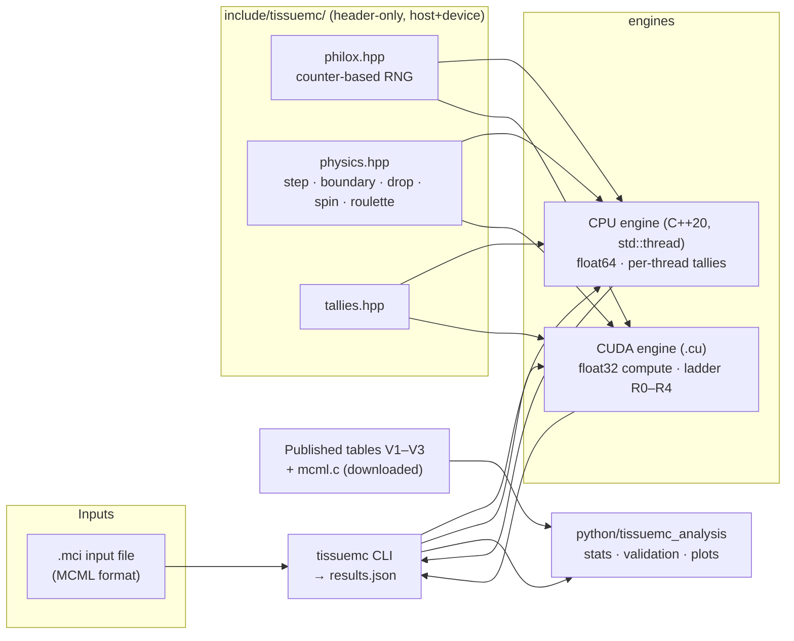

# TissueMC — Design Document

**Status:** Draft for review. Implementation starts only after Raghava approves this document.
**Date:** 2026-10-13
**Author:** Raghava Dwivedi (design, validation, benchmarking). Implementation is AI-assisted; see [Development process](#9-development-process).

---

## 1. Problem

Light entering biological tissue scatters thousands of times before it's absorbed or leaves the tissue. Many applications depend on knowing where that light goes:

- pulse oximetry and PPG sensors in wearables
- near-infrared spectroscopy
- laser dosimetry
- how deep a microscope can image

No closed-form solution exists for realistic tissue.

The standard answer is a **Monte Carlo simulation**: launch millions of virtual photon packets and track each one through random scattering and absorption events. The reference implementation is **MCML** (Wang, Jacques & Zheng, 1995). It's written in C, runs on one CPU thread, and its manual includes published validation results.

Monte Carlo photon transport is *embarrassingly parallel*, since photons don't interact with each other. That makes it a natural fit for GPUs. It's also a hard GPU workload, for four reasons:

| Challenge | Why it's hard |
|---|---|
| **Warp divergence** | Each photon lives a random number of steps. On a GPU, 32 threads execute in lockstep, so threads with finished photons sit idle. |
| **Atomic contention** | Every photon deposits energy into shared tally arrays. Thousands of threads updating the same memory serialize. |
| **Random number streams** | Every thread needs an independent, reproducible stream of random numbers. |
| **Floating-point precision** | Summing ~10⁸ small contributions in float32 silently loses accuracy. |

## 2. What this project is, and isn't

**It is:**
- A validated, instrumented reimplementation of MCML's layered-tissue model.
- A C++ CPU reference plus one CUDA GPU backend.
- An optimization study that measures each GPU design decision and records it.

**It isn't new science.** GPU MCML already exists: CUDAMCML (Alerstam et al., 2008) and MCX (Fang & Boas, 2009). The project's value is in three things:
1. Correctness checked against **published values the AI didn't write**.
2. An honest, reproducible performance study.
3. Code the author can explain end to end.

The README says this plainly.

## 3. Goals and non-goals

### Goals

| ID | Goal |
|---|---|
| G1 | Reproduce MCML's published validation results within statistical error. Cases are in §5. |
| G2 | Multithreaded C++ CPU engine (float64), measured from 1 to 12 threads on an M4 Pro. |
| G3 | CUDA engine on an NVIDIA T4 (free Colab or Kaggle). Every optimization step passes the validation suite before its speed is recorded. |
| G4 | A measured optimization ladder (§6). For each step: a result and an explanation, with hypotheses labelled and checked by the next step. |
| G5 | Honest baselines: CPU thread scaling, the original `mcml.c`, and MCX on the same GPU. MCX comparisons are approximate (§7). |
| G6 | One-command reproduction of the validation suite on any machine; one notebook reproduces the GPU numbers. |

### Non-goals (MVP)

- 3-D voxelized geometry (MCX's domain)
- time-resolved or fluorescence simulation
- arbitrary beam shapes
- polarization
- a GUI
- Metal/MLX backend (fallback only, see §11)

## 4. Physics model (MCML-equivalent)

Inputs are a stack of planar layers. Each layer has a refractive index *n*, absorption coefficient μa, scattering coefficient μs, anisotropy *g* and thickness *d*. The media above and below the stack have their own refractive indices.

The source is a pencil beam at normal incidence.

Each photon packet carries a weight *W* that starts at 1 − R_sp, where R_sp is the specular reflectance at the surface. It then repeats this loop:

1. **Step size.** Sample s = −ln(ξ)/μt, where μt = μa + μs and ξ ~ U(0,1]. If the step would cross a layer boundary, move to the boundary and carry the unused, dimensionless remainder of the step into the next layer.
2. **Boundary.** At an interface, compute the Fresnel reflectance R(θi) from Snell's law. Total internal reflection applies above the critical angle. Draw ξ: reflect if ξ ≤ R, otherwise transmit.
   - A photon that transmits out of the top surface is scored as **reflectance**.
   - One that transmits out of the bottom is scored as **transmittance**.
   - This is MCML's default, non-split boundary scheme.
3. **Absorb ("drop").** Deposit ΔW = W·μa/μt into the absorption tally at the photon's position, then set W ← W − ΔW.
4. **Scatter ("spin").** Sample the deflection angle from the Henyey–Greenstein phase function, with the azimuth uniform in [0, 2π). Then update the direction cosines and renormalize them. MCML's rotation formula does not preserve vector length when the input is slightly off, and it amplifies the error for |u_z| above about 0.6: harmless in float64 (worst measured |norm² − 1| of 6.6e-9 over 1.8e8 events). In float32 the unit-direction invariant is violated (|norm² − 1| > 1e-5) in 6.3% of events without renormalization, and in none with it; the aggregate V2 reflectance did not change at six digits, so this is an invariant violation, not a measured bias. Renormalizing costs one square root and leaves the model unchanged.
5. **Russian roulette.** If W < W_th = 10⁻⁴, the photon survives with probability 1/m (m = 10) and its weight becomes m·W; otherwise it dies. Constants are from MCML manual Table 5.1 (WEIGHT = 1×10⁻⁴, CHANCE = 0.1). Roulette is *unbiased*: the expected weight is unchanged.

**Tallies** (MCML definitions):

| Tally | What it records |
|---|---|
| Specular reflectance R_sp | Reflection at the surface, before the photon enters |
| Total diffuse reflectance R_d | All weight leaving through the top surface |
| Total transmittance T_t | All weight leaving through the bottom, *including* unscattered light |
| Absorption per layer | Total weight deposited in each layer |
| A(z) | Absorption binned by depth |
| R_d(r) | Diffuse reflectance binned by radius |

**Conservation check.** R_sp + R_d + T_t + ΣA should equal 1 in expectation, because roulette is unbiased. This is a built-in test.

## 5. Validation: the independent oracles

Correctness is never judged only by tests written alongside the code. There are three independent sources of truth.

### 5.1 Published values

Source: MCML manual (Wang & Jacques), Chapter 6. Verified against the primary PDF on 2026-10-13.

| Case | Medium | Published reference |
|---|---|---|
| **V1**, Table 6.1 | Slab: n = 1 (matched), μa = 10, μs = 90 cm⁻¹, g = 0.75, d = 0.02 cm | R_d: van de Hulst 0.09739; MCML 0.09734 ± 0.00035 · T_t: van de Hulst 0.66096; MCML 0.66096 ± 0.00020 |
| **V2**, Table 6.2 | Semi-infinite: n = 1.5, μa = 10, μs = 90 cm⁻¹, g = 0 | **Total** reflectance R_d + R_sp (R_sp = 0.04): Giovanelli 0.2600; MCML 0.25907 ± 0.00170; Prahl 0.26079 ± 0.00079. See the note below |
| **V3**, Tables 6.6/6.7 | Three-layer tissue, n = 1.37, ambient 1.0. Layers: (μa 1, μs 100, g 0.9, 0.1 cm), (1, 10, 0, 0.1 cm), (2, 10, 0.7, 0.2 cm) | R_d: MCML 0.2375; Gardner 0.2381 · T_t: MCML 0.0965; Gardner 0.0974. **No standard errors published**, so V3 uses a looser, documented tolerance |

**Note on V2.** The three values in Table 6.2 are total reflectance (diffuse plus specular), not diffuse alone, even though the table is described as diffuse reflectance. The evidence is the independent oracle in §5.6, which gives 0.2197 diffuse and 0.2597 total for this medium; all three published values sit near 0.26. Tables 6.1 and 6.7 are diffuse-only (Table 6.7 matches this implementation's diffuse reflectance, not its total).

**Why these three cases:**
- V1 tests anisotropic scattering and a matched boundary. Its T_t includes the unscattered light, exp(−2) ≈ 0.13534.
- V2 tests Fresnel reflection at a mismatched boundary and specular reflection.
- V3 tests multiple layers, carrying steps across layer boundaries, and a realistic g = 0.9.

### 5.2 Statistical test

1. Split N photons into B independent batches. Photon weights aren't Bernoulli trials, so the standard error has to come from the spread of batch means.
2. Compute the mean and standard error SE across batches.
3. Compute the z-score: z = (ours − ref) / √(SE_ours² + SE_ref²).
4. **Pass if |z| < 3.**
5. Also check 1/√N convergence: quadrupling N should roughly halve SE.

### 5.3 Analytic unit tests

| Test | What's checked |
|---|---|
| Purely absorbing slab (μs = 0) | T matches the closed-form Beer–Lambert transmittance, including Fresnel at both faces |
| R_sp | Matches ((n₁ − n₂)/(n₁ + n₂))² |
| Fresnel R(θ) | At 0°, at Brewster's angle, and above the critical angle (expect 1) |
| Henyey–Greenstein sampler | Sample mean of cos θ ≈ g (statistical test) |
| Step-size sampler | Sample mean ≈ 1/μt |
| Random number generator | Known-answer test vectors from the Random123 reference implementation |

### 5.4 The original `mcml.c`

The original program is a second implementation written by other people.

- The user downloads the five source files from OMLC into `third_party/mcml/`. **They are not redistributed in this repo** (the page states no license). `tissuemc-compare-mcml` checks them against pinned SHA-256 values.
- The tool compiles them locally, outside the source directory, with the 1993 sources unmodified.
- It runs the **same `.mci` input files**, because TissueMC reads MCML's input format, as many independent runs in one launch.
- Its outputs are compared statistically at equal photon counts, with a standard error on both sides.

The original is single-threaded, so it also serves as the single-threaded CPU baseline.

**Result of this check (2026-10-14).** The original's generator turned out to matter. At 1×10⁷ photons all comparisons passed; at 4×10⁷ the V3 transmittance differs by 2×10⁻⁴ (5σ), and the difference vanishes when only the original's random number generator is replaced. So the original is a good check of this engine's transport logic but, at high statistics, not a gold standard for the last 10⁻⁴. Details are in the README and `BUILD_LOG.md`.

### 5.5 Cross-precision check

The CPU (float64) and GPU (float32) engines share the same counter-based random number generator, keyed by photon ID. So both simulate *the same photons*, and their aggregate results must agree within statistical error. This catches GPU-specific bugs that a test against the published tables alone might hide.

### 5.6 Independent analytic oracle

For a semi-infinite, isotropically scattering medium, the reflectance has a first-principles solution (Chandrasekhar's H-function, plus a boundary recursion for a refractive-index mismatch). It lives in `python/tissuemc_analysis/oracle.py`, shares no code or modelling choices with the engine, and is tested against identities that follow from the integral equation.

It supplies two reference values that depend on no published table:

| Case | Medium | Oracle value |
|---|---|---|
| **O1** | Matched boundary (n = 1), μa = 10, μs = 90 cm⁻¹, g = 0 | R_d = 0.414947 |
| V2 (extra check) | n = 1.5, same medium | R_d = 0.219704 (diffuse); 0.259704 total |

**Measured tightness.** Because both precisions draw the same numbers for photon *i*, a photon takes almost the same path in either, and only a tiny fraction flip an outcome through rounding. On V3 at 10⁶ photons the float32 and float64 totals differ by 2.8×10⁻⁶ in R_d against a standard error of 3.0×10⁻⁴, about a hundred times tighter than statistical noise, and per-batch sums differ by under 5×10⁻⁴ relative. On the thin slab (V1) the gap is fifty thousand times below the standard error. The CPU float32 path runs the same physics code as the GPU kernel, so this is also a local stand-in for it, and the GPU engine will be held to the same standard: per-batch agreement with the CPU on identical photons, not just agreement within noise.

**Rule:** no throughput number is recorded for any engine or optimization step unless V1–V3 and O1 pass on that exact build. The benchmark harness enforces this.

## 6. GPU optimization ladder

Each rung is one small, reviewable change. For every rung:

1. The change ships with a one-page explainer.
2. **`LOG.md` is measurement-only:** it records what was measured and what the data suggest, not a forecast. (R0 and R1 were run without a prediction, and the author chose not to write them from then on.) A hypothesis is written down after a run, labelled as one, and the next run says whether it held.
3. Raghava runs one Colab cell. It builds the code, validates V1–V3, benchmarks, and writes `results/rung-N.json`.
4. Raghava commits the result and reviews the log entry.

| Rung | Change | What it teaches | Measured by |
|---|---|---|---|
| **R0** | Naive. One thread per photon; per-thread Philox RNG; float32 transport; tallies accumulated with **float64** `atomicAdd` in global memory. A float32-totals mode demonstrates the stall: measured on the host (absorbed weight 1.6% low at 4×10⁵ photons per batch) and on the GPU (energy conservation fails, z = −82.5) | Baseline GPU execution model; why float32 totals are unsafe | photons/s; validation z-scores; the float32 demonstration |
| **R1** | **Fewer atomics.** R0 does two global atomic adds per absorption event (about 10⁹ per second at R0's speed). Absorbed weight per layer is accumulated in the thread and flushed once per photon; the depth and radius profiles stay global until R2 | The cost of global atomics | photons/s; atomics per photon |
| **R2** | **Atomic privatization.** Each block keeps its own histograms (A(z), R_d(r)) in shared memory and flushes them to global memory once | Contention and the memory hierarchy | photons/s; atomics per photon |
| **R3** | **Photon relaunch / persistent threads.** When a photon dies, its thread pulls the next photon ID from a global counter instead of idling | Warp divergence | photons/s; **average active threads per warp** from Nsight Compute (4.75 of 32 for R0 and R1), with in-kernel sampling only if `ncu` is unavailable |
| **R5** | **State in registers.** One photon per thread as in R1, but the random generator's buffer and the per-layer accumulator are held in registers instead of run-time-indexed arrays (`RegPhotonRng`, `GpuTallyR5`) | Per-thread local memory | photons/s; local-memory instructions, stall reasons and L1 hit rate from Nsight Compute |
| **R6** | **Relaunch with state in registers.** R3's persistent lanes with R5's register state | Relaunch once the memory problem is gone | same |
| **R7** | **Profiles in shared memory.** R6 with the depth and radius profiles kept in a private copy per warp in shared memory and flushed once per block (the privatization planned as R2, applied to R6 after the diagnostic showed the profile atomics were 92% of R6's time) | Atomic contention and the memory hierarchy | photons/s against R6 and against the profiles-off diagnostic; atomic and L2 counters |
| **R8** | **Combine same-bin lanes.** R7 with the lanes of a warp that add to the same depth bin summing their weights first (`__match_any_sync`, `__shfl_sync`) so that one lane per bin makes the shared-memory add (R7's counters showed about 19 compare-and-swap iterations per add, a double-precision pipe 77% busy and 6× the divergent branches) | Warp-level cooperation and the cost of retry loops | photons/s against R7 and the profiles-off diagnostic; shared-atomic iterations, double-precision pipe use, divergent branches |
| **R4** | **Math and launch tuning.** Fast intrinsics (`__expf`, `__logf`, `sincosf`); sweep block sizes for occupancy | Instruction cost vs. accuracy; occupancy | photons/s; whether z-scores still pass |

**Order change after R1.** Rung numbers are names, not a schedule. R1's hardware counters (memory throughput 14%, L2 12%, 4.75 of 32 lanes active per warp) show warp divergence, not memory traffic, as the main loss, so **R3 is built next and R2 is deferred**. R2 stays in the ladder; whether it still helps is measured once divergence has been addressed.

**After R3.** R3 raised the active lanes per warp from 4.74 to 21.61 of 32 and was about 6% slower than R1. Lane utilization is therefore not what limits the kernel, and R1's reading that divergence was the main loss did not hold. The next step was a measurement (warp stall reasons, local-memory counters), not another rung; R2 stays deferred.

**After the diagnosis.** The stall breakdown put 93% of R3's per-instruction wait on the load/store path, all of it per-thread local memory (no global or shared traffic, no register spills), with the L1 hit rate for local loads falling from 90% to 29%. That was the cause of R3's extra wait. The next rungs, R5 and R6 (state in registers, without and with relaunch), remove the run-time-indexed per-thread arrays from the hot loop; with R1 and R3 they form a two-by-two comparison. Rung numbers are names, not a schedule; R4 (math and launch tuning) and R2 stay in the ladder.

**After R5 and R6.** R5 and R6 took 10.06 s and 10.05 s, equal to R1's 10.06 s, while R3 took 10.76 s. Local memory was what slowed R3 (R6 recovers it) but not what limits R1: with it gone, nothing moved. R1, R5 and R6 share a floor that these runs do not identify. The depth-profile atomic (one per event, the same in all three) was the leading candidate, and R6's counters point at it: its only load/store instructions are atomics, the wait moved from local-memory loads to the full load/store queue, and one L2 slice runs at 64% of peak against a 2% average. The deferred R2 (shared-memory histograms) is the rung that fixes it; the earlier reason for deferring it, that L2 was only about 12% busy, did not measure hot-address serialization. A diagnostic that removes the atomic came first, to test the reading rather than assume it, and it confirmed it: R6 without the depth and radius profile atomics took 0.82 s instead of 10.05 s (12.2× faster), so those atomics are 92% of R6's time. The fix is the privatization rung planned as R2, applied to R6 and called R7 ([`docs/rungs/R7.md`](rungs/R7.md)).

**After R7.** R7 took 1.96 s against R6's 10.05 s (5.1× faster) with the profiles kept and checked against the CPU, closing 88% of the gap to the profiles-off diagnostic (0.85 s). What remains, 1.1 s above the diagnostic, is not yet attributed.

**Profiling.** If Nsight Compute (`ncu`) hardware counters are available on the free tier (tested in the week-1 smoke test), the study adds counter evidence. If not, everything above still works with in-kernel counters and `clock64()` timing, so no claim depends on `ncu`.

**Workload.** Validation runs on V1–V3. Benchmarks run on a **tissue-like case** (semi-infinite, μa = 0.1, μs = 100 cm⁻¹, g = 0.9, n = 1.37) and on V3:
- V1 photons are short-lived (μa/μt = 0.1), so V1 is too light to stress the GPU.
- In the tissue-like case each photon takes hundreds to thousands of steps, which exposes divergence.

## 7. Benchmarking methodology

| Item | How it's handled |
|---|---|
| **Metric** | Photons per second, and scattering events per second. |
| **Repetitions** | Report the median of k ≥ 5 runs with the IQR. Warm-up runs are excluded. Seeds are fixed. |
| **Hardware recorded with every result** | GPU name, driver, CUDA version, and clocks (`nvidia-smi`); CPU model and thread count; compiler and flags; git commit. All of it is written to the results JSON. |
| **Comparisons (never "vs. a single thread")** | **CPU scaling:** 1, 2, 4, 8, 12 threads on the M4 Pro. Macs can't pin threads, and efficiency cores add noise, so this is stated. **`mcml.c`:** original single-threaded MCML on the same machine and inputs. **MCX (`pmcx`) on the same T4:** MCX uses voxels and MCML uses layers, so the comparison uses a homogeneous semi-infinite medium and is labeled *approximate*. If `pmcx` doesn't run on the free tier, that's reported rather than hidden. |
| **What will not be claimed** | Any speedup target decided in advance. We report what we measure. |

## 8. Architecture



### Key design decisions

| Decision | Choice | Why | Alternative rejected |
|---|---|---|---|
| Sharing physics code between CPU and GPU | One header. A `TMC_HD` macro expands to `__host__ __device__` under nvcc and to nothing under clang | The CPU reference and the GPU kernel run *the same physics code*. The Mac (no NVIDIA GPU) can test the physics locally; only the thin CUDA wrapper needs Colab | Separate CPU and GPU physics, which doubles the code that can diverge |
| RNG | **Philox4x32-10** (Salmon et al., SC'11), hand-written in a header and keyed by (seed, photon ID) | Counter-based, so no stored state per thread. Any thread can simulate any photon reproducibly, which enables the cross-precision check and rung R3. Verified with known-answer tests | cuRAND (CUDA-only, so it can't be shared with the CPU); `std::mt19937` (big per-thread state, not GPU-friendly) |
| Interface | C++ CLI that reads `.mci` and writes JSON. Python only does analysis | Fewer moving parts to explain. Identical inputs work with `mcml.c`. A batch simulator gains little from Python bindings | pybind11/nanobind bindings: more build complexity for no measurement benefit |
| CPU precision | float64 throughout | This is the reference that the float32 GPU is checked against | — |
| GPU precision | float32 compute; tallies fixed in R1 | float32 is the GPU's fast path. Per NVIDIA's T4 spec, FP64 runs at a small fraction of FP32 (to be confirmed and cited at R4) | float64 on the GPU: correct but slow on a T4 |
| Build | CMake (from PyPI) + `uv` for Python | Works on macOS (Command Line Tools only), Linux CI, and Colab | Xcode, which isn't installed |

### Error handling

- **Input validation.** Every `.mci` field is range-checked (n ≥ 1, μa ≥ 0, μs ≥ 0, −1 < g < 1, d > 0, layer count ≥ 1). Errors name the field and line, and the program exits non-zero.
- **CUDA calls.** Every CUDA API call and kernel launch is checked by a `CUDA_CHECK` macro that reports file and line.
- **NaN guard.** A kernel counter tracks photons whose direction becomes NaN or non-normalized. Results are rejected if the count is nonzero, and a test asserts it stays 0.
- **Benchmark gate.** The benchmark harness refuses to write throughput results if validation fails.

## 9. Development process

| Role | Responsibilities |
|---|---|
| **Raghava Dwivedi** | Design and specification. Runs every GPU benchmark on his own Colab/Kaggle account. Reviews results. Writes the project write-up and `VALIDATION.md`'s narrative. |
| **AI coding assistant** | Implements code to this specification, under review. |

**Files that keep the record:**
- `VALIDATION.md` maps each claim to the independent check that verifies it, and lists **only real defects**, copied from `BUILD_LOG.md`, which is kept during the build.
- `LOG.md` records each rung's measurements and what they suggest.

## 10. Repository layout and engineering bar

```
tissuemc/
  README.md  LICENSE (MIT)  VALIDATION.md  BUILD_LOG.md  LOG.md  CHANGELOG.md
  CMakeLists.txt  pyproject.toml (analysis package; uv)
  include/tissuemc/   hd.hpp philox.hpp physics.hpp tallies.hpp config.hpp mci.hpp
  src/cpu/            engine.cpp
  src/cuda/           engine.cu  rungs/r0.cu … r4.cu
  src/cli/            main.cpp
  python/tissuemc_analysis/   stats.py validate.py bench.py plots.py
  configs/validation/ v1_slab.mci v2_semi_inf.mci v3_three_layer.mci (+ reference values with citations)
  configs/bench/      tissue_g09.mci
  tests/cpp/          (doctest) physics, RNG known-answer tests, mci parser, conservation
  tests/python/       (pytest) stats, validation logic
  notebooks/          colab_gpu.ipynb (one cell per rung)
  tools/              colab_smoke_test.ipynb  fetch_mcml.sh (download + checksum, no redistribution)
  results/            rung-*.json  cpu-*.json  (committed; small)
  docs/               DESIGN.md  INTERVIEW_PREP.md  derivations.md
  .github/workflows/  ci.yml
```

### CI (GitHub Actions; runs on every push and PR)

| Job | What it runs |
|---|---|
| macOS + Ubuntu | Build; C++ unit tests; validation **V1–V3 on the CPU engine** at reduced photon counts with appropriately widened, documented tolerances; pytest |
| Sanitizers | ASan + UBSan build of the tests |
| Formatting and lint | clang-format and ruff checks |
| **CUDA compile-only** | Installs the CUDA toolkit and compiles the `.cu` files for `sm_75`. GitHub runners have no GPU, so this catches compile errors *before* a Colab session is spent |

**One-command reproduction:** `uv run tissuemc-validate`, which builds the code and runs V1–V3 on the CPU.

**Commit practice:** small commits per milestone, with conventional messages.

## 11. Milestones

| # | Milestone | Done when | Needs Raghava |
|---|---|---|---|
| M0 | Repo skeleton, license, CI green, this design doc | CI passes on an empty build | Approve public repo creation |
| M1 | Physics core + RNG + unit tests | Analytic tests pass | — |
| M2 | Single-thread CPU engine + `.mci` parser + JSON output | **V1, V2, V3 pass in float64** | — |
| M3 | Multithreaded CPU engine + Python stats, validation, and plots | Scaling curve from 1 to 12 threads; conservation test passes | Run it once on his Mac to confirm it reproduces |
| M4 | `mcml.c` baseline harness | Our results and `mcml.c`'s agree statistically on V1–V3 | Approve the download |
| M5 | CUDA R0 + Colab notebook | R0 passes V1–V3 on a T4 | **Week-1 smoke test**, then the first GPU run |
| M6–M9 | Rungs R1–R4 | Each rung validates, benchmarks, and has its result and explanation logged | Colab run + commit + log entry per rung |
| M10 | MCX comparison, README results table, plots, `VALIDATION.md` | All README numbers trace to committed result files | Runs `pmcx` on the same T4 |

**Target dates:**
- Build (M0–M10): Oct 26 – Dec 4, 2026
- Write-up: January 2027

## 12. Risks

| Risk | Likelihood | Mitigation |
|---|---|---|
| No free T4 GPU, or `nvcc` missing on Colab | Medium | Try Kaggle's T4. If that also fails, MLX on the Mac becomes the deep GPU backend (verified to work locally), and claims are rescoped. |
| `ncu` counters blocked on the free tier | Medium–High | In-kernel instrumentation (§6); no claim depends on `ncu`. |
| `pmcx` doesn't run, or the MCX comparison is unfair | Medium | Label it approximate; try CUDAMCML; otherwise report CPU baselines only. |
| V3 has no published standard errors | Certain | Use a documented tolerance derived from Gardner–MCML disagreement and photon count; V1/V2 carry the strict test. |
| The author can't explain part of the system | Medium | A per-rung log of measurements and explanations, CPU/GPU shared physics code (less to learn), a design review before the GPU study is published. |
| Prior-art question ("why not MCX?") | Certain | Honest answer: "MCX is faster and more general. I needed a reference I could validate and instrument; here's the measured gap and which design choice explains it." |
| `mcml.c` licensing | Low | Downloaded by script with checksum, never redistributed. |
| Time | High | Implementation milestones don't need the author's time; per-rung work (run, review) is about 30–45 min. |

## 13. Success criteria

All three must hold:

1. **Correctness.** V1 and V2 pass with |z| < 3 against MCML's published values on both engines. V3 passes its documented tolerance. Energy is conserved within 3σ. Results agree with `mcml.c`.
2. **Performance study.**
   - GPU throughput on the T4 for the tissue-like case at every rung, each rung validated.
   - The CPU scaling curve on the M4 Pro.
   - The `mcml.c` comparison.
   - The MCX comparison, or a documented reason it couldn't be done.
   - The float32 tally stall demonstrated and fixed.
3. **Reproducibility.** Every README number traces to a committed result file and the command that produced it.

## References

- Wang L., Jacques S.L., Zheng L. *MCML — Monte Carlo modeling of light transport in multi-layered tissues.* Comput. Methods Programs Biomed. 47:131–146 (1995). Manual: Wang & Jacques, *Monte Carlo Modeling of Light Transport in Multi-layered Tissues in Standard C* (1992), Chapter 6, Tables 6.1, 6.2, 6.6, 6.7.
- Alerstam E., Svensson T., Andersson-Engels S. *Parallel computing with graphics processing units for high-speed Monte Carlo simulation of photon migration.* J. Biomed. Opt. 13(6):060504 (2008). (CUDAMCML)
- Fang Q., Boas D.A. *Monte Carlo simulation of photon migration in 3D turbid media accelerated by graphics processing units.* Opt. Express 17(22):20178 (2009). (MCX)
- Salmon J.K., Moraes M.A., Dror R.O., Shaw D.E. *Parallel random numbers: as easy as 1, 2, 3.* SC'11 (2011). (Philox)
- Henyey L.G., Greenstein J.L. *Diffuse radiation in the galaxy.* Astrophys. J. 93:70–83 (1941).

*Exact page and volume details will be re-checked against each primary source when they're cited in the README.*
